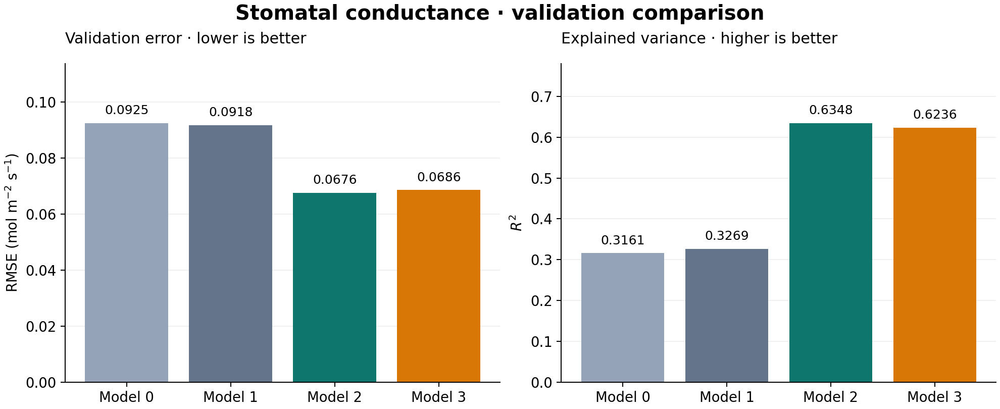
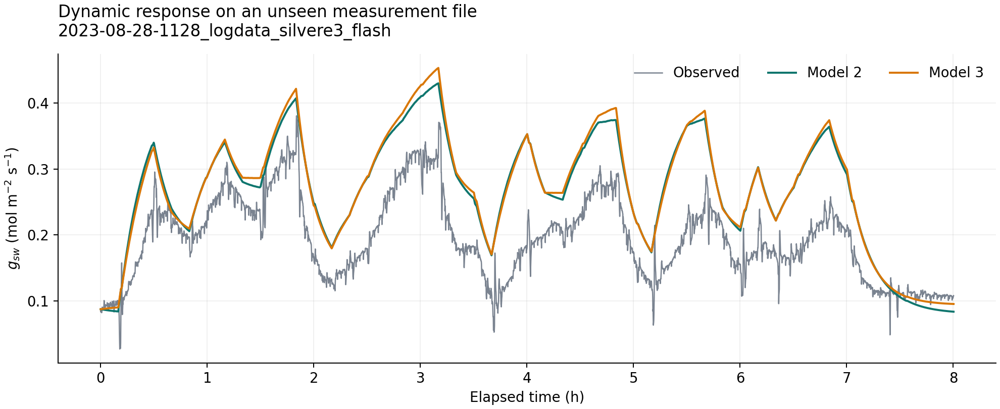

# Stomatal Conductance Modeling

[](https://github.com/benbenbeatit912002/stomatal-conductance-modeling/actions/workflows/tests.yml)

Predicting how stomata respond to changing light using LI-6800 gas exchange measurements, mechanistic models, and independent validation files.

This project compares four models, progressing from a static light response to separate stomatal opening and closing dynamics. The analysis connects plant physiology with a reproducible Python workflow: instrument parsing, quality control, parameter estimation, evaluation, and visualisation.



## Main result

**Adding a dynamic response improves prediction on the validation files.** Model 2 achieves a validation RMSE of **0.0676 mol m⁻² s⁻¹** and an R² of **0.6348**, compared with an RMSE of 0.0925 for the static empirical baseline. Separate opening and closing rates in Model 3 do not improve validation performance in this experiment.

| Model | Approach | Validation RMSE ↓ | Validation R² ↑ | Validation bias |
|---|---|---:|---:|---:|
| Model 0 | Empirical light and VPD response | 0.0925 | 0.3161 | 0.0005 |
| Model 1 | Leuning-style target with simulated assimilation | 0.0918 | 0.3269 | 0.0008 |
| Model 2 | Leuning target with one response rate | 0.0676 | 0.6348 | 0.0110 |
| Model 3 | Separate opening and closing rates | 0.0686 | 0.6236 | 0.0122 |

RMSE and bias use mol m⁻² s⁻¹; bias is predicted minus observed conductance. Results apply to the supplied file split and cleaning rules. Dynamic models use the first measured conductance of each file as an initial condition. See [full metrics](reports/reference/model_comparison.csv), [fitted parameters](reports/reference/parameters.json), and [run provenance](reports/reference/run_manifest.json).



The time-series example uses the first validation file in filename order. All five validation files contribute to the metrics above.

## What the project demonstrates

- Parsing instrument exports with metadata, units, and duplicate column names.
- Applying quality controls while preserving independent experimental files.
- Implementing physiological models and fitting parameters with bounded robust least squares.
- Evaluating generalisation with RMSE, R², bias, and time-series plots.
- Packaging scientific code with a command-line entry point, regression checks, and GitHub Actions.

The notebook also contains exploratory Ridge and LSTM residual corrections, sensitivity analysis, and Monte Carlo parameter uncertainty. These extensions are separate from the four-model benchmark shown above.

## Quick start

Use **Python 3.11** for the reference environment. From a terminal:

```bash
git clone https://github.com/benbenbeatit912002/stomatal-conductance-modeling.git
cd stomatal-conductance-modeling
python -m venv .venv
```

Activate the environment on Windows PowerShell:

```powershell
.\.venv\Scripts\Activate.ps1
```

Or on macOS / Linux:

```bash
source .venv/bin/activate
```

Install and run the core analysis from the repository root:

```bash
python -m pip install -r requirements.txt
python -m pip install -e . --no-deps
python -m stomatal_conductance --data-dir Data --output-dir outputs
```

The equivalent installed command is `stomatal-analysis`. A run fits Models 0–3 on `Data/Training`, evaluates both splits, and writes:

```text
outputs/
├── model_comparison.csv
├── parameters.json
├── run_manifest.json
├── model_comparison.png
└── validation_timeseries.png
```

The manifest records input SHA-256 hashes, retained rows per file, model bounds, package versions, and optimizer convergence. Generated runs in `outputs/` are ignored by Git. The published reference artifacts live in `reports/reference/`.

An optional `--max-nfev 5` caps optimizer work for a smoke run. Such a run may not converge and is not suitable for comparing model quality; the command returns a nonzero status if any model fails to converge.

## Explore the notebook

```bash
python -m pip install -e ".[notebook]"
python -m jupyterlab notebooks/stomatal_conductance.ipynb
```

Select the kernel belonging to this virtual environment, then run cells from top to bottom. The default run includes data exploration, Models 0–3, and sensitivity analysis. The setup cell contains three switches:

| Switch | Default | Enables |
|---|---|---|
| `RUN_RIDGE` | `False` | Regularised residual correction |
| `RUN_LSTM` | `False` | Neural residual correction, 40 training epochs |
| `RUN_MONTE_CARLO` | `False` | Model 3 parameter uncertainty sampling |

For the LSTM section, first install `python -m pip install -e ".[lstm]"`. Enable switches before running the notebook from the beginning. Monte Carlo sampling and LSTM training require additional time and memory. Set `STOMATAL_DATA_DIR` to use a different data directory in the notebook.

The original `Load_data.ipynb` has been reorganised as [`notebooks/stomatal_conductance.ipynb`](notebooks/stomatal_conductance.ipynb). Core functions now import from the package; saved execution outputs are cleared to keep notebook diffs readable.

## Project structure

```text
├── Data/                         # Original LI-6800 exports; fixed file split
│   ├── Training/                 # 6 experimental files
│   └── Validation/               # 5 experimental files
├── src/stomatal_conductance/
│   ├── data.py                   # Instrument parser and split loading
│   ├── _preprocessing.py         # Quality control and modelling filters
│   ├── models.py                 # Four mechanistic model equations
│   ├── fitting.py                # Parameter bounds, fitting, evaluation
│   ├── metrics.py                # RMSE, R², bias
│   ├── plotting.py               # Notebook diagnostics
│   ├── reporting.py              # Exported benchmark figures
│   └── cli.py                    # Reproducible experiment entry point
├── notebooks/                    # Analysis and exploratory extensions
├── reports/reference/            # Reference metrics, figures, provenance
├── docs/                         # Data, methods, and literature notes
├── tests/                        # Synthetic-data tests
├── .github/workflows/tests.yml    # Windows and Linux test workflow
├── pyproject.toml                # Package metadata and dependency ranges
└── requirements.txt              # Exact core versions for the reference run
```

## Data and modelling assumptions

The dataset has 11 LI-6800 exports with 62,226 raw observations. Files remain in their original training and validation folders; rows are not randomly split across these time series. The parser expects extensionless exports containing a `[Data]` section.

Models use light, CO₂, and leaf VPD. Assimilation is simulated from light; measured assimilation is used for quality filtering and diagnostics. Models 2 and 3 restart from the first measured `gsw` in each file. Their rates apply per retained observation, so the current implementation does not adjust dynamics for irregular time intervals after filtering.

The experiment has a small number of independent files, several parameters reach their fitting bounds, and the validation set is used to compare candidate models. These results are exploratory and would need a further independent test set for a final generalisation estimate. The residual models and covariance-based uncertainty analysis have additional assumptions documented in [methods and limitations](docs/methodology.md).

The project originated in plant physiology coursework at Wageningen University & Research. See the [dataset summary](docs/data_summary.md) and [data provenance](Data/README.md). No project licence or separate raw-data redistribution licence has been selected in this repository.

## Verification

```bash
python -m unittest discover -s tests -v
```

Tests use synthetic exports and check parsing, invalid-data handling, file-boundary resets, independence from later observed conductance, metric definitions, and an end-to-end artifact export. GitHub Actions is configured to run this suite on Windows and Linux with Python 3.11. The full course dataset is not needed for these tests.

## Background reading

- [Damour et al. 2010 — stomatal conductance review notes](docs/references/damour_2010_stomatal_conductance_summary.md)
- [Katzin et al. 2020 — GreenLight model notes](docs/references/greenlight_literature_summary.md)

The GreenLight material provides greenhouse context. This repository implements the stomatal models described above; it does not implement the GreenLight simulator.
